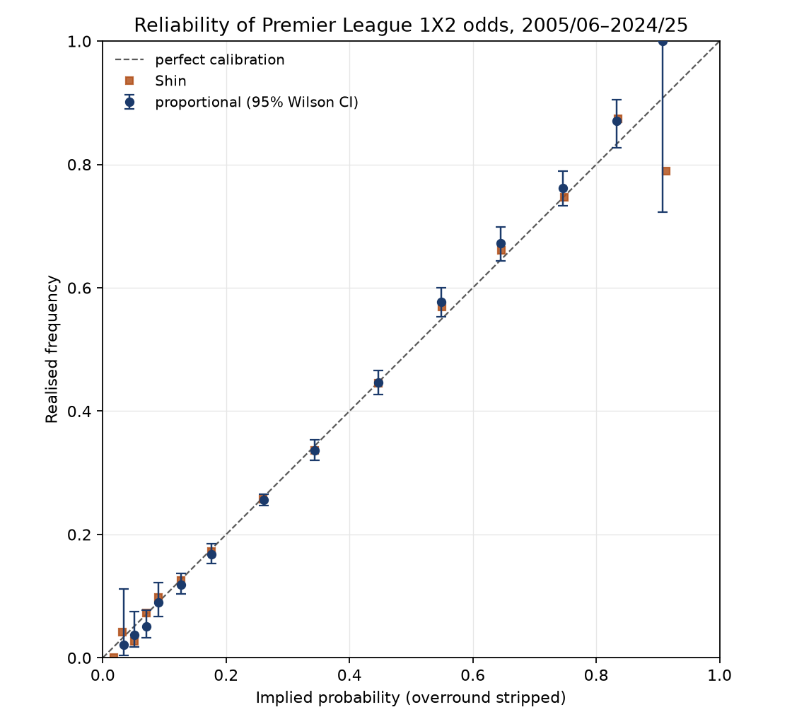
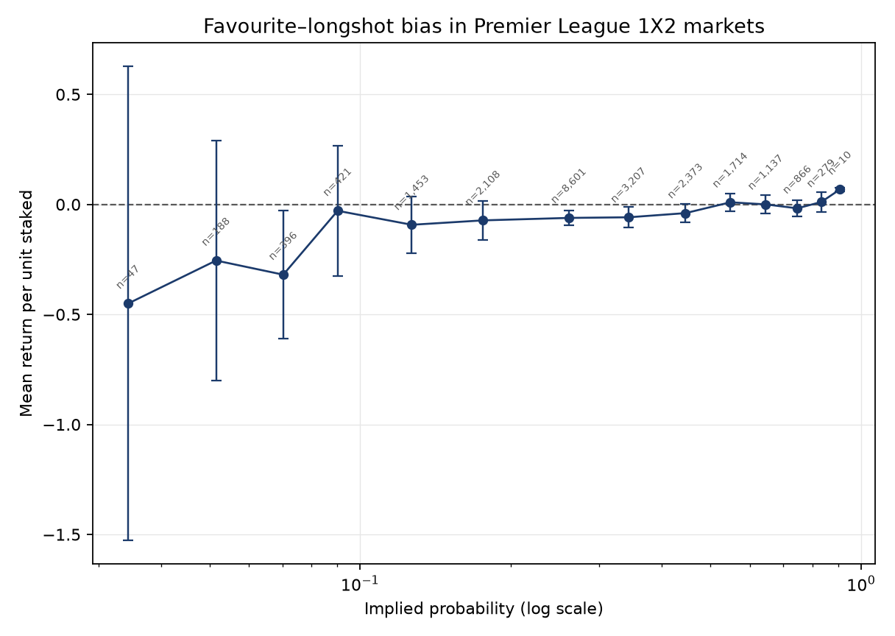
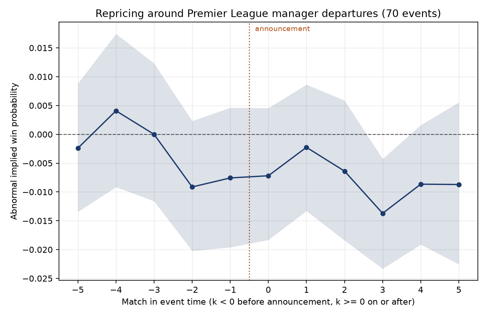
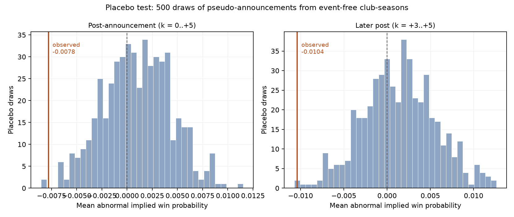
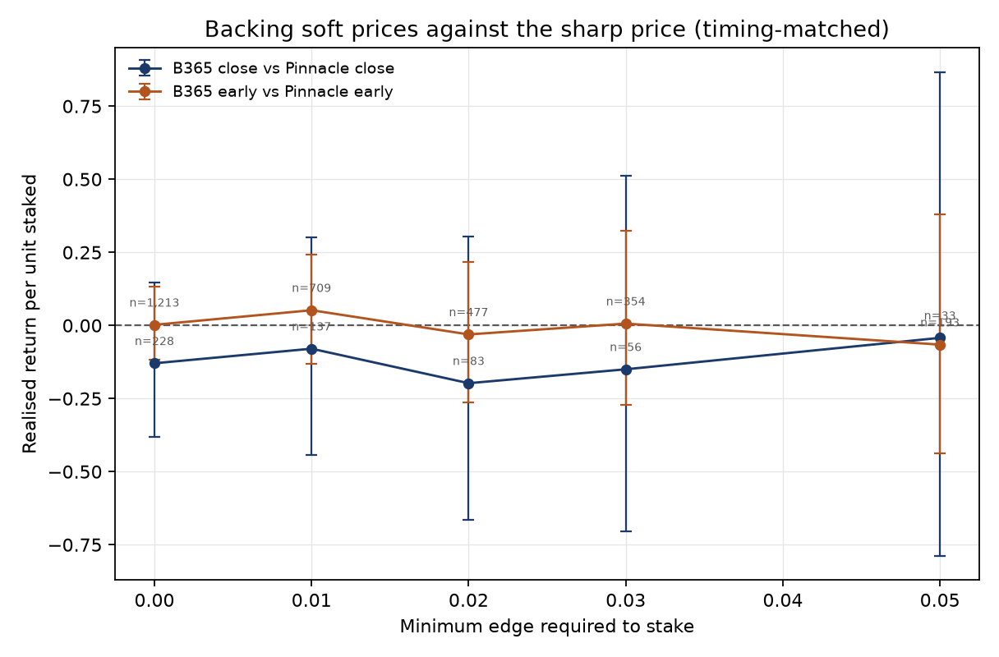

# Overround

**Calibration and event-time repricing in the English Premier League match-odds market, 2005/06-2024/25**

## Abstract

Fixed-odds football markets are prediction markets with an unusually clean settlement rule: three mutually exclusive outcomes, a known resolution date, and a posted price. They are also quoted gross of a bookmaker margin, the *overround*, which must be removed before a price can be read as a probability. This study measures that margin, tests whether the de-margined prices are calibrated forecasts, uses the same prices as an event-time asset to measure how the market reprices a club when its manager is dismissed, and asks whether any bookmaker's price is exploitably wrong relative to the sharpest available quote.

The market is well calibrated. Over 22,800 outcome-level observations the reliability curve is statistically indistinguishable from the diagonal across the mid-range, with an n-weighted mean absolute deviation of 0.9 percentage points and a linear-probability slope of 1.06 (s.e. 0.02). The classic favourite-longshot bias survives in pooled data: bets at implied probabilities below 0.10 return −19.8% per unit staked, against +0.1% for bets above 0.50, though the tail estimate rests largely on the pre-2012 sample. Around 70 manager departures, abnormal implied win probability is significantly negative *after* the announcement (−0.78 pp, 95% CI [−1.46, −0.09]) and insignificantly negative before it. A 500-draw placebo test on pseudo-announcements sampled from event-free club-seasons places that estimate outside the 95% null interval (p = 0.032), while the pre-announcement estimate is indistinguishable from the null (p = 0.370). There is no evidence of a new-manager bounce being priced in; the market marks a sacking club down and keeps it down for at least five matches.

Nothing in these prices is exploitable. Backing the best available quote against Pinnacle's de-margined probability returns nothing distinguishable from zero at any staking threshold, and the apparent +8.0% at a 3% threshold dissolves under inspection: ten bets out of 1,779 supply 123% of the profit, and excluding a single season leaves +0.44% (95% CI [−9.8%, +11.4%]). At a per-bet return standard deviation of 2.48, roughly 14,800 bets, some fifty Premier League seasons, would be needed to establish a 4% edge. The design that ignores quote timing reports +3.4% on bets that a timing-matched design scores at −1.5%, which is the size of the bias that sloppy timestamps introduce.

## Data

Match results and closing decimal 1X2 odds for the English Premier League are taken from football-data.co.uk, twenty complete seasons from 2005/06 through 2024/25. Every season contributes its full 380-match programme; the panel is 7,600 matches and 22,800 outcome observations, spanning 13 August 2005 to 25 May 2025.

Exactly one quote is retained per match, selected by a fixed bookmaker priority: Pinnacle closing (`PSCH/PSCD/PSCA`), else Pinnacle (`PSH/PSD/PSA`), else the market average (`BbAv*`/`Avg*`), else Bet365. Pinnacle closing quotes begin in 2012/13 and cover 65.0% of the sample; the market average covers 2005/06-2011/12, the remaining 35.0%. Rows with a missing quote, a non-standard result code, or any decimal odd at or below 1.0 are dropped; none of the twenty seasons lost a match to these filters. The source used is recorded per row, since the two regimes differ sharply in margin and must not be pooled uncritically.

## Methods

**De-margining.** Gross implied probabilities are the reciprocals of the decimal odds; their sum less one is the overround. Two strippings are computed: proportional normalisation, and Shin's (1993) insider-trading adjustment, in which the insider share *z* is solved per match by Brent root-finding on the constraint that the adjusted probabilities sum to one. Proportional probabilities are the headline series; Shin probabilities are reported alongside and are close to identical away from the extreme tails.

**Calibration.** All home, draw and away outcomes are pooled as (implied probability, realised 0/1) pairs and binned on fixed edges, deciles between 0.10 and 0.90, finer bins in both tails where the favourite-longshot bias lives. Realised frequencies carry 95% Wilson score intervals. The favourite-longshot test is the mean return on a one-unit stake, `win × odds − 1`, by bin, with normal-approximation intervals.

**Event study.** The design follows MacKinlay (1997) with calendar time replaced by match time. For each departure, the club's matches within the same season are indexed *k* = −5…+5 relative to the announcement (*k* < 0 strictly before, *k* ≥ 0 on or after). The outcome is the club's de-margined implied win probability. The benchmark is a club-season OLS regression of that probability on a home dummy and opponent strength, the opponent's season-average implied win probability, estimated on the club's matches *outside* every event window in that season, so a second sacking in the same season cannot contaminate the first one's benchmark. Abnormal probability is the residual against that benchmark. Confidence intervals are percentile bootstraps over 5,000 draws that resample whole events, clustering inference at the event level.

The event list (`src/sackings.csv`) is hand-compiled: 70 prominent, unambiguous Premier League manager departures between September 2007 and December 2024, across 29 clubs. Events require at least 8 matches inside the ±5 window; all 70 clear that bar, with a minimum realised window of 9 matches and a median of 11, yielding 767 club-match observations.

**Placebo.** The event study is falsified against pseudo-announcements. Each of 500 draws samples 70 club-seasons carrying no departure, 333 are available, and places a pseudo-announcement at the same within-season match index as a real event, so that any artifact of where in a campaign the window sits is reproduced rather than assumed away. The identical pipeline then runs on the synthetic list. Because `src/sackings.csv` records prominent departures rather than every managerial change, some club-seasons treated as event-free did see one; that contamination pulls the null toward the observed estimate and makes the test conservative.

**Soft versus sharp.** Pinnacle is treated as the sharp book and its de-margined probabilities as the best available estimate of truth. A soft quote *o* on the same outcome is a positive-expectation bet when `p_sharp × o − 1` clears a staking threshold; every qualifying outcome is backed for one unit and scored at `win × o − 1`, with percentile bootstraps resampling whole matches. Quote timing is the binding constraint: a soft price and the sharp price it is measured against must be sampled at the same moment, or the test uses information that postdates the soft quote. Two timing-matched comparisons are run, closing against closing, available for all books from 2019/20, and early against early, available for Pinnacle and Bet365 from 2012/13, alongside a deliberately contaminated look-ahead variant that quantifies the bias.

## Results

**The overround has collapsed.** The market-average book charged 9.45% of stake in 2005/06, falling monotonically to 6.08% by 2011/12. Pinnacle closing quotes, available from 2012/13, charge 2.38% on average, bottoming at 2.04% in 2014/15 and drifting back to 2.99% in 2024/25. Shin's insider share tracks this closely: 3.83% under the market average against 1.20% at Pinnacle's close, consistent with the margin being roughly twice the estimated adverse-selection component in both regimes.



**Prices are honest probabilities.** The reliability diagram sits on the 45° line through the body of the distribution: the n-weighted mean absolute deviation between binned implied and realised frequencies is 0.0091, and a linear-probability regression of realisation on implied probability gives a slope of 1.0603 (s.e. 0.0165) with intercept −0.0201, a slope marginally above one, which is the signature of mild under-confidence at the extremes rather than of miscalibration in level. Shin and proportional strippings are visually coincident above an implied probability of about 0.05.



**The favourite-longshot bias is intact and steep.** Mean return per unit staked rises almost monotonically in implied probability: −45.0% in the lowest populated bin (implied 0.02-0.04, n = 47), −25.5% and −31.9% in the next two, −9.3% at implied 0.10-0.15, and approximately zero from 0.50 upward (+0.10% for the pooled p > 0.50 bins, n = 4,006). Pooled across all bins below 0.10 the return is −19.8% on 1,052 bets. The tail bins are thin and their intervals wide, sample sizes are printed on the figure rather than suppressed, but the gradient across the well-populated middle is unambiguous and far larger than the overround alone can explain.



**Sackings are repriced downward, not upward.** Average abnormal implied win probability is −0.30 pp over the five matches before an announcement (95% CI [−1.07, +0.49]) and −0.78 pp over the six from the announcement onward (95% CI [−1.46, −0.09]). The pre-window path is flat then softening: +0.06 pp at *k* = −5…−3 against −0.84 pp at *k* = −2…−1 (CI [−1.70, +0.05]), with an estimated drift of −0.24 pp per match (CI [−0.52, +0.04]), suggestive of anticipation, but not separable from zero at conventional levels. Post-announcement the mark-down deepens rather than reverses: −0.53 pp over *k* = 0…+2 (CI [−1.30, +0.28]) against −1.04 pp over *k* = +3…+5 (CI [−1.87, −0.24]). Against a mean in-window win probability of 0.346, a one-percentage-point mark-down is roughly a 3% relative revision. The market treats a dismissal as confirmation of decline, not as a catalyst; whatever new-manager bounce exists is not priced into the following five fixtures.



**The event-study result survives falsification.** Across 500 draws of pseudo-announcements the null distribution of post-announcement abnormal probability centres on +0.10 pp with a standard deviation of 0.34 pp and a 95% interval of [−0.55, +0.79] pp, the machinery does not manufacture a mark-down when pointed at departures that never happened. The observed −0.78 pp falls outside that interval (p = 0.032), as does the −1.04 pp at *k* = +3…+5 (null +0.14 pp, p = 0.026). The pre-announcement estimate does not survive: −0.30 pp against a null of −0.04 pp gives p = 0.370, so the apparent anticipation drift should be read as noise. The placebo null is tighter than the event-clustered bootstrap because it resamples club-seasons rather than events; the two procedures test different nulls and agree in direction.



**No soft price is exploitably wrong.** Not one confidence interval excludes zero across four timing-matched comparisons and five staking thresholds. The strongest single figure, backing the best available closing quote against Pinnacle's closing probability at a 3% threshold, +8.0% on 1,779 bets, does not withstand inspection. The ten most profitable bets contribute 174.1 units against a total of 141.8, so the remaining 1,769 lose 32 units between them; the median bet returns −1.000 and the hit rate is 24.1%. Four of six seasons are positive, but 2019/20 alone returns +45.6%, and excluding it leaves +0.44% (95% CI [−9.8%, +11.4%]). The per-bet return standard deviation of 2.479 implies that roughly 14,800 bets, about fifty Premier League seasons at this selection rate, would be needed to separate a 4% edge from zero, so the question is not merely unanswered here but unanswerable at this sample size. Bet365 alone almost never beats Pinnacle, improving on it in 25.1% of early quotes and clearing a positive edge in 8.2%. The look-ahead control behaves as designed: comparing early soft quotes to sharp *closing* probabilities reports +3.4% on bets that the timing-matched comparison scores at −1.5%, a five-point artifact from timestamp discipline alone.

## Limitations

Closing quotes are available only from 2012/13, so the pre-2012 half of the sample is a cross-bookmaker average of unknown timing, carrying three times the margin and a correspondingly noisier probability. Calibration and favourite-longshot estimates therefore pool two different price regimes. Split by regime, calibration holds in both, slope 1.1047 (s.e. 0.0301) under the market average against 1.0407 (s.e. 0.0198) at Pinnacle's close, with weighted absolute deviations of 0.0139 and 0.0083, and the longshot-to-favourite gradient is positive in both. The tail estimate is not equally robust: the sub-0.10 return is −35.8% (s.e. 15.7) under the market average but −12.7% (s.e. 12.5) at Pinnacle's close, the latter indistinguishable from zero. The headline −19.8% is carried disproportionately by the older, wider book, and this study cannot establish that the favourite-longshot bias survives at modern closing prices.

Event dates are hand-compiled from public reporting rather than from a vendor corporate-actions file. Seven of the seventy are flagged in `src/sackings.csv` and `NOTES.md` as confident only to within a day or two; at match frequency this matters only when an announcement sits on a matchday. Departures are also heterogeneous, outright dismissals, resignations under pressure, and mutual-consent exits are pooled, and the announcement date is not the date the market learned that a manager was doomed.

Match-frequency granularity is the binding constraint on the event study. A Premier League club plays roughly weekly, so *k* = ±5 spans two to three months of calendar time, and any repricing that happens within hours of an announcement is invisible here: the earliest post-event observation is the next fixture, which the incoming or caretaker manager has already taken. Higher-frequency intraday quotes would separate announcement effects from subsequent performance news; this design cannot. Opponent strength is a full-season average and so is measured in-sample, and the benchmark's estimation sample spans both the outgoing and incoming manager's matches, which biases abnormal returns toward zero.

The placebo test bounds but does not eliminate the specification risk. It shows the benchmark does not manufacture a mark-down on pseudo-events matched for club-season and season position, which is the artifact most likely to arise here; it cannot rule out a confound correlated with genuine departures but not with sackings themselves, a run of poor results, for instance, would move both the sacking hazard and the club's price. This design cannot separate the announcement from the form that provoked it, and the estimate should be read as the market's response to the whole episode rather than to the news alone.

The soft-versus-sharp backtest assumes a bettor can transact at the recorded quote for a normal stake. In practice soft bookmakers restrict or close accounts that win consistently, so a positive result would have understated the difficulty of realising it. The negative result is unaffected by this, but it does mean the exercise is a test of price efficiency, not a costed trading study.

## Reproduce

```
pip install -r requirements.txt
make all
```

`make all` runs download -> build -> calibrate -> eventstudy -> placebo -> softsharp, about seven minutes end to end, of which the 500-draw placebo is roughly six. Individual stages are available as targets (`make eventstudy`, `make placebo`, …). The download step fetches twenty small CSVs from football-data.co.uk into `data/raw/` and is idempotent; both `data/raw/` and `data/processed/` are gitignored, while `figures/` and `results/` are checked in. Every stage asserts its own preconditions, 380 matches per season, stripped probabilities summing to one, a plausible overround band, a minimum event window, and fails loudly rather than emitting a plausible wrong answer. Requires pandas, numpy, matplotlib and scipy only; developed on Python 3.12 and verified on 3.9.
